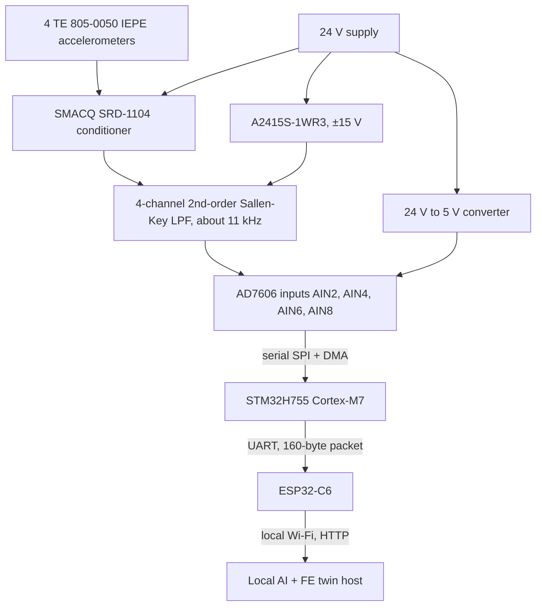
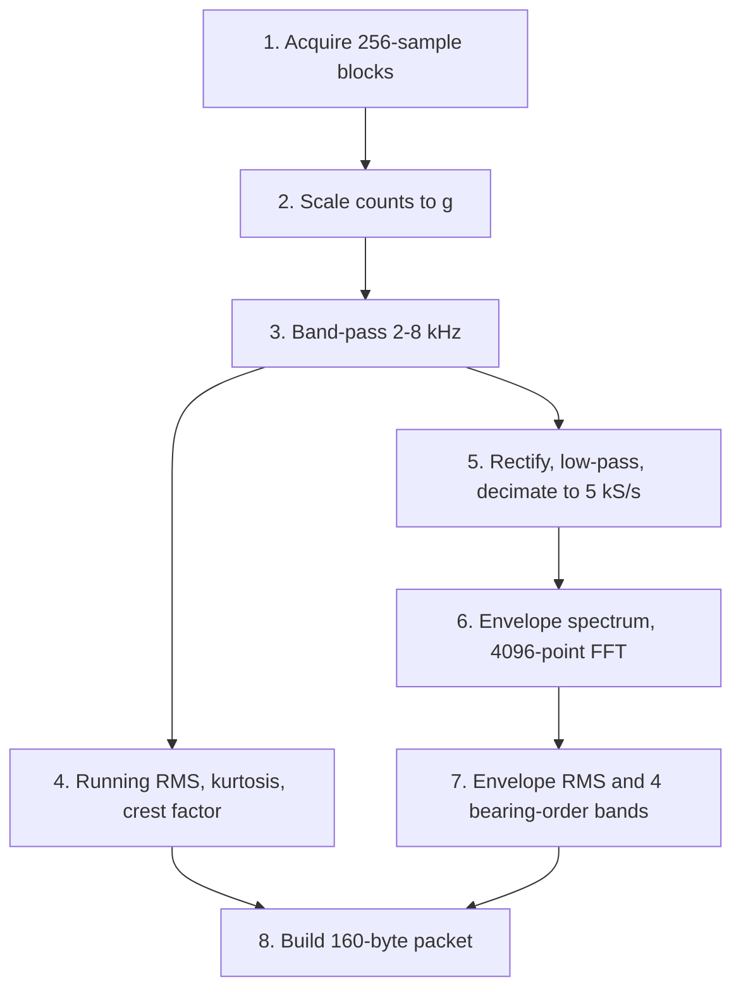
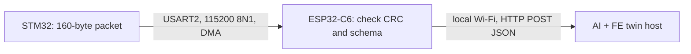

# Real-Time Edge AI Bearing Monitoring System
## COE Edge Acquisition and Processing Node

*Status as of 5 November 2026: built and measured on the bench with real accelerometers.*

### 1. Purpose and Scope

The system monitors a Bently Nevada RK4 rotor kit in two steady operating modes: **1750 RPM** and **3600 RPM**. The system has three layers:

1. **Mechanical layer:** the rotor kit, its bearings and the accelerometers generate the measurements.
2. **COE edge layer:** the AD7606 and STM32 acquire four vibration channels, process every 20-revolution window into 32 AI features, and send a fixed 160-byte packet through the ESP32-C6.
3. **ICS layer:** a local host runs the AI model, the FE digital twin and the 2D dashboard.

The COE layer receives **four accelerometer channels** for bearing-fault features. Proximity probes, the Keyphasor and shaft-displacement outputs are optional future work (Section 9); they are not part of the built system.

---

### 2. Specification Mapping

S1–S3 and C1–C2 are this layer's own labels. In the team's final table (see `overview/Project Overview.md`): S1 = COE1, S2 = COE2, S3 = COE3, C1 = C4 (local processing) and C2 = C2 (SELV IEPE excitation). In the team specification sheet, S1–S3 are Specifications 4–6.

| Requirement | How the design meets it | Measured evidence |
| :--- | :--- | :--- |
| **S1** Sample at least 25,000 S/s per channel, 4 channels | AD7606, oversampling off, converts all 8 inputs at once; the STM32 reads 4 of them | **29,998.5 S/s per channel**, measured every second from BUSY timestamps; **0 lost samples** in runs of 45, 133 and 44 s and in live runs with sensors |
| **S2** Features ready within 333 ms after a window ends | Streaming DSP while data arrives; only the FFT and final features run at the window end | Recorded data: **91.0 ms** (1750 RPM), **47.9 ms** (3600 RPM). Live with sensors: 156/156 windows, typically 10–11 ms, **worst 16.1 ms** |
| **S3** Fixed AI representation at both speeds | Same 32 features in the same order every window, in a fixed 160-byte packet | Recorded data: 32 features at both speeds, every stage matched the Python reference. Live: 32 values per window; a 5 kHz sine gives kurtosis 1.50 (theory 1.5) and crest factor 1.42 (√2) |
| **C1** Acquisition and processing local, no cloud | All DSP on the STM32 Cortex-M7; the ESP32-C6 only forwards finished packets on the local network | Live runs computed and printed all features with no network connected |
| **C2** SELV (≤ 50 V DC) IEPE excitation, 24 V / about 4 mA | SRD-1104 conditioner on the 24 V bus | 24 V at the conditioner; IEPE 0 excitation **4.275 mA**; largest span in the node about 39 V; powered sensors sit at 10.9 V bias (datasheet 8–12 V) |
| Team **C6** ≤ 1 % window loss over a 1-hour run (shared with ME) | Error counters; a window with any lost sample is dropped and counted | 0 lost windows in every run so far (longest 133 s); the 1-hour run is not done yet |

Note on S3 (COE3): the team table states 1000–3600 RPM. The firmware supports the two settled modes, 1750 and 3600 RPM; other speeds would need a new window length (or the Keyphasor, Section 9).

---

### 3. Hardware Architecture

#### 3.1 Sensors and Conditioning

The accelerometers are **TE Connectivity Model 805-0050**: 2-wire IEPE, nominal **100 mV/g** (±10 %), ±50 g range, flat within ±1 dB from 1 Hz to 8 kHz, resonance 34 kHz. Pin 1 is the signal (+OUT), pin 2 is ground (the case), pin 3 is unused.

The SRD-1104 powers each sensor with about 4 mA of constant current from the 24 V supply and passes the vibration signal to its rear outputs. Each output then passes through one channel of the custom low-pass filter before reaching the ADC.

The low-pass filter is a **second-order unity-gain Sallen-Key Butterworth** stage per channel ($R_1=R_2=10\ \mathrm{k\Omega}$, $C_1=2\ \mathrm{nF}$, $C_2=1\ \mathrm{nF}$, calculated $f_0=11.25$ kHz). All four channels share one TL074, powered at ±15 V from an isolated A2415S-1WR3 module. The AD7606's own analog input filter adds to it; its digital oversampling is off. Measured response of filter plus ADC: −0.4 dB at 5 kHz, −1.6 dB at 8 kHz, **−3.0 dB at 10 kHz**, −7.2 dB at 14 kHz. Design details: [LPF Design Details](LPF-design-details.md).

#### 3.2 ADC Channel Assignment

| Accelerometer (conditioner input) | AD7606 input | Pipeline channel |
| :--- | :---: | :--- |
| IEPE 0 | AIN2 | B1X, bearing 1, X |
| IEPE 1 | AIN4 | B1Y, bearing 1, Y |
| IEPE 2 | AIN6 | B2X, bearing 2, X |
| IEPE 3 | AIN8 | B2Y, bearing 2, Y |

AIN1, AIN3, AIN5 and AIN7 are converted but not used. On the bench (November 2026), three sensors are connected; the fourth has no cable yet, so conditioner output 2 also feeds filter 3, and B2X temporarily carries a copy of the IEPE 1 sensor. The map was confirmed by tapping one sensor at a time: each tap moved only its own channel.

#### 3.3 Power and Grounding

| Rail | Source | Feeds | Measured |
| :--- | :--- | :--- | :--- |
| 24 V | Bench supply | SRD-1104, 5 V converter, A2415S-1WR3 | 24 V |
| 5 V | 24→5 V converter, wired directly to the ADC | AD7606 | 5.1 V (the AD7606 needs 4.75–5.25 V; through the breadboard it fell to 4.6 V) |
| ±15 V | A2415S-1WR3 isolated module | TL074 | +15.1 V / −15.1 V |

The STM32 and ESP32-C6 run from their own USB cables. All grounds (conditioner, filter, ADC, STM32, ESP32, converter returns and the A2415S-1WR3 0 V) form **one 0 V network**. Because the A2415S-1WR3 is isolated, its 0 V must be wired to that network explicitly. When that link was missing, the filter outputs drifted by volts. The largest voltage span in the node is about 39 V (+24 V to −15 V).

#### 3.4 Sampling

| Item | Value |
| :--- | :--- |
| Conversion start | STM32 TIM4: 200 MHz ÷ 6667 = **29,998.5 S/s**, CONVST A and B together |
| ADC settings | Oversampling off (`OS[2:0] = 000`), ±5 V range, serial mode |
| Read trigger | BUSY falling edge → highest-priority interrupt → SPI1 + DMA read of all 8 results |
| SPI clock | 6.25 MHz; 128 bits take 20.5 µs |
| Timing per sample | 33.3 µs period = about 4.15 µs conversion + 20.5 µs read, about 8 µs spare |
| Buffer | Ring of 16 blocks × 256 sample sets × 8 inputs (64 KiB), about 136 ms of cover |
| Error counters | Missed conversions, read overlaps, ring overruns, DMA/SPI errors and stalls, reported every second |

The SPI clock was set to 6.25 MHz, below the first 10 MHz plan, because ringing on the long clock wire caused one-bit shifts. With the slowest pin edge rate and 6.25 MHz no doubled values occurred. A start-up self-test checks the ADC (BUSY timing, shorted or floating lines, serial mode) before every acquisition start.

---

### 4. Windowing and Memory

#### 4.1 Twenty-Revolution Window

A window covers **20 shaft revolutions at the nominal speed**. Without a shaft reference, its length is fixed by the configured RPM:

> Window samples per channel = 30,000 × 60 × 20 ÷ RPM

| Shaft speed | Window duration | Samples per channel | Envelope samples (÷ 6) |
| :---: | :---: | :---: | :---: |
| 1750 RPM | 685.7 ms | 20,571 | 3,429 |
| 3600 RPM | 333.3 ms | 10,000 | 1,667 |

Windows follow each other without gaps. Filter and decimation states carry across blocks and windows. Any acquisition error (a missed conversion, read overlap, ring overrun, or DMA or SPI error) drops the affected data and restarts the stream, so no window contains missing samples.

The 333 ms requirement is a **processing** requirement. Its timer starts at the last sample of a window.

#### 4.2 Memory Approach

Raw windows are never stored. The DSP processes each 256-sample block (8.53 ms of data) as it arrives and keeps only:

| Data | Size |
| :--- | :--- |
| ADC sample ring (DMA target) | 64 KiB |
| Envelope records, 4 channels × up to 3,429 Float32 | about 55 KB |
| FFT workspace | about 63 KB |
| Running statistics and filter states | small |

The LIVE firmware uses about 121 KB of the 512 KB AXI SRAM and 78 KB of the 128 KB DTCM. DMA buffers are in AXI SRAM because DMA cannot reach DTCM.

---

### 5. Processing Pipeline

#### 5.1 Steps

| Step | Definition |
| :--- | :--- |
| Scale | ADC counts × (10 V ÷ 65,536) ÷ (0.100 V/g) → g; one sensitivity per channel in `live_config.h` |
| Band-pass | Butterworth order 8 (four biquads), 2–8 kHz, causal, at 30 kS/s |
| Time features | RMS (no mean removal), Pearson kurtosis (Gaussian = 3), crest factor; one-pass moments in double precision |
| Envelope | Absolute value → Butterworth order 7 low-pass (flat within 0.1 dB to 350 Hz, ≥ 60 dB attenuation from 1250 Hz) → keep 1 sample in 6 (5 kS/s) |
| Spectrum | Whole-window envelope: remove mean, Hann window of the actual length, zero-pad to 4096, real FFT; 1.22 Hz bins; one-sided PSD |
| Frequency features | Envelope RMS (including its mean), plus the RMS of the PSD inside ±0.10 order around each bearing order: √(ΣPSD × 5000/4096) |

The order of a bin is `frequency ÷ (RPM ÷ 60)`. A 20-revolution record gives a physical resolution of 1/20 = 0.05 order; zero-padding only makes the grid denser.

The 2–8 kHz band is a starting value for the installed assembly. It can be changed later if measured vibration, for example a kurtogram, shows a more impulsive band.

#### 5.2 Eight Features per Channel

| Local index | Feature | Unit | Purpose |
| :---: | :--- | :--- | :--- |
| 0 | Band-pass RMS | g | Overall vibration level |
| 1 | Band-pass kurtosis | – | Impulsiveness |
| 2 | Band-pass crest factor | – | Peaks relative to RMS |
| 3 | Envelope RMS | g | Overall impact modulation |
| 4 | FTF band RMS | g | Cage evidence |
| 5 | BSF band RMS | g | Rolling-element evidence |
| 6 | BPFO band RMS | g | Outer-race evidence |
| 7 | BPFI band RMS | g | Inner-race evidence |

Features are ordered by channel: B1X 0–7, B1Y 8–15, B2X 16–23, B2Y 24–31.

Bearing profile 1 (project, **provisional**) uses the orders supplied by the mechanical team. Profile 2 (CWRU drive end: 0.39828, 2.35675, 3.5848, 5.4152) is available for testing with public data.

| Family | Order | At 1750 RPM | At 3600 RPM |
| :--- | :---: | :---: | :---: |
| FTF | 0.38 | 11.1 Hz | 22.8 Hz |
| BSF | 1.98 | 57.8 Hz | 118.8 Hz |
| BPFO | 3.05 | 89.0 Hz | 183.0 Hz |
| BPFI | 4.95 | 144.4 Hz | 297.0 Hz |

A channel that is constant or zero gets zero features and a cleared validity bit, which is not a "healthy" label.

---

### 6. Packet and Communication

For every window, the STM32 builds one **160-byte packet** (schema 1, little-endian):

| Bytes | Type | Field |
| :---: | :--- | :--- |
| 0–3 | ASCII | Marker `COE1` |
| 4–5 | UInt16 | Schema version, 1 |
| 6–7 | UInt16 | Feature count, 32 |
| 8–11 | UInt32 | Window ID, counts from 1 after each stream start |
| 12–15 | UInt32 | Nominal RPM, 1750 or 3600 |
| 16–19 | UInt32 | Bearing profile ID |
| 20–23 | UInt32 | Channel-valid mask, bit 0 = B1X … bit 3 = B2Y |
| 24–27 | UInt32 | Unit ID, 1 = g |
| 28–155 | Float32[32] | Features in the order of Section 5.2 |
| 156–159 | UInt32 | CRC-32 (zlib) of bytes 0–155 |

The marker, metadata and CRC let the receiver find packet boundaries and reject corrupted or mismatched packets. Packets are sent only when every channel has a calibration (volts per g), because every packet declares g.

- **STM32 → ESP32:** USART2 TX (PD5) → ESP GPIO18, 115200 8N1, sent by DMA; one packet takes 13.9 ms on the wire, well inside a 333 ms or 686 ms window. ESP GPIO19 → PD6 returns a delivery acknowledgment used by the timing test.
- **ESP32-C6:** validates the CRC, schema and values, queues up to 16 vectors, and sends each as HTTP POST JSON to the host, with up to three attempts and an idempotency key. It does not recalculate anything.
- **Host:** decodes the same fixed layout and uses the 32 features as one input row.

---

### 7. Processing Locations

| Device | Work |
| :--- | :--- |
| STM32H755 Cortex-M7 (400 MHz) | ADC control and DMA, start-up self-test, error counters, all DSP, the 32 features, packet construction |
| STM32H755 Cortex-M4 | Not used (starts and idles) |
| ESP32-C6 | UART reception, validation, Wi-Fi/HTTP forwarding |
| Local host | AI fault classification and RUL, FE beam model, 2D dashboard; no cloud connection |

Measured DSP load during live acquisition is about 16 % of the Cortex-M7.

---

### 8. Verification

| Requirement | Test | Result |
| :--- | :--- | :--- |
| **S1** | Count BUSY edges against the cycle counter every second, with error counters | 29,998.50 S/s, 0 missed/lost samples in every run (45, 133, 44 s, and 107 s with sensors) |
| **S2** | Time from a window's last sample to finished features | Recorded data 91.0 / 47.9 ms; live 16.1 ms worst over 156 windows; limit 333 ms |
| **S3** | Compare every DSP stage with the Python reference on recorded data; check the live output | All recorded-data checks passed (time features, band-pass, envelope, FFT over all 2049 bins, frequency features, streaming pipeline, packet decoder); live: 32 features per window, valid mask 0xf |
| **C1** | Run the full chain with no network | Features computed and printed on the STM32 alone |
| **C2** | 24 V and IEPE current in series with a 3.3 kΩ load | 24 V; 4.275 mA on IEPE 0 |

Additional measurements:

- **Analog response:** −3.0 dB at 10 kHz (filter + ADC), all four inputs equal within about 1 mV.
- **Noise floor with sensors:** 0.3 mV RMS per channel (about 3 mg); in LIVE, band-pass RMS about 1.2 mg with kurtosis about 3 when still.
- **Sensor response:** taps on each sensor raised only its own channel (0.4–1.6 g band-pass RMS); moving the breadboard gave 20–120 mg on all channels.
- **Delivery:** recorded-data packets were delivered STM32 → ESP32 → host in October 2026. Live-sensor delivery to the ESP32 is not verified yet: in the 2 November run the STM32 sent all packets, but no bytes reached the ESP32 (wiring to be checked).

---

### 9. Open Items and Optional Future Work

Open items for the built system:

1. Verify live packet reception at the ESP32 and HTTP delivery to the host, then run LIVE for 10 minutes or more with delivery.
2. Fit a cable for the fourth sensor and remove the temporary B2X copy.
3. Mount the sensors rigidly on the bearing housings (adhesive or stud, per the 805 datasheet) instead of the breadboard.
4. Check calibration against a known vibration, or use per-serial calibration sheets; the nominal 0.100 V/g is used now.
5. Measure the 20–28 kHz analog response (aliasing into 2–8 kHz).
6. Measure the IEPE 1–3 excitation currents and do one power test with everything on.
7. Confirm the rig speed and the real bearing's orders before AI training (profile 1 is provisional).

Optional future work (not committed):

- **Keyphasor:** a timer-capture input for measured RPM, revolution-accurate windows and a phase reference. Today windows use the nominal RPM.
- **Proximity probes:** two RK4 radial probes on AD7606 inputs through the RK4 Proximitor units, with input protection, and a synchronous 1x amplitude/phase per probe for the FE twin. This would add four Float32 values to the packet.
- **Angular resampling:** only needed if speed varies enough inside a window to smear the order peaks; it requires the Keyphasor.
- **Fourth-order filter:** a second Sallen-Key stage if aliasing appears in tests.

---

## Bill of Materials

| Component | Role | Source / status |
|---|---|---|
| STM32 NUCLEO-H755ZI-Q | Acquisition, timing and DSP | [Amazon](https://www.amazon.sa/-/en/XFCZMG-NUCLEO-H755ZI-Q-Nucleo-144-Development-STM32H755ZI/dp/B0CKVZ2X7Z) — in use |
| AD7606 eight-channel ADC module | Simultaneous sampling; 4 of 8 inputs used | [AliExpress](https://www.aliexpress.com/item/1005012637207490.html) — in use, serial mode, ±5 V |
| TE Connectivity 805-0050 accelerometers (×4) | Vibration measurement, 100 mV/g IEPE | In use (three connected; fourth needs a cable) |
| SMACQ SRD-1104 | IEPE power and conditioning, 4 channels | [AliExpress](https://ar.aliexpress.com/item/1005007510744310.html) — in use |
| BNC-to-jumper cables | Sensor to SRD-1104 inputs | In use; sensors are on a breadboard because the jumper ends do not hold the sensor pins |
| TL074CN quad op-amp (×1) and DIP-14 socket | Four Sallen-Key filter stages | [AliExpress](https://ar.aliexpress.com/item/1005006131796020.html), [sockets](https://ar.aliexpress.com/item/1005006130784050.html) |
| 10 kΩ 1 % metal-film resistors (×8) | Filter resistors | [AliExpress](https://ar.aliexpress.com/item/1005008289034002.html) |
| 1 nF ceramic capacitors (×12), 100 nF (×2), 1 µF (×1) | Filter capacitors, decoupling, module input | [AliExpress](https://ar.aliexpress.com/item/1005009570762979.html) |
| 10 µF electrolytic capacitors (×2) | Bulk decoupling of the ±15 V rails | [AliExpress](https://ar.aliexpress.com/item/1005008123014567.html) |
| A2415S-1WR3 isolated DC-DC converter | 24 V → ±15 V for the TL074 | [AliExpress](https://ar.aliexpress.com/item/1005006169352485.html) — in use; its 0 V must be tied to the circuit ground |
| 24 V → 5 V DC-DC converter | 5 V for the AD7606 | [AliExpress](https://ar.aliexpress.com/item/1005008965910286.html) — in use, wired directly to the ADC |
| Breadboard and jumper wires | Prototype filter and sensor mounting | In use |
| Universal double-sided perfboard, terminal blocks, UL1007 22-AWG wire | Final soldered filter board | [Perfboard](https://ar.aliexpress.com/item/1005003647800709.html), [terminals](https://ar.aliexpress.com/item/1005007055503766.html), [wire](https://ar.aliexpress.com/item/1005005450270866.html) — the soldered version is not built yet |
| ESP32-C6 development board | UART to local Wi-Fi bridge | [AliExpress](https://www.aliexpress.com/item/1005012742424741.html) — in use |
| 24 V supply | Powers the node | Bench supply (the first one failed internally on 2 November 2026 and was replaced) |
| Proximitor-to-ADC protection, Keyphasor conditioning | Only for the optional future work | Not purchased |

---

## References

1. [COE Processing Pipeline Component Details](COE_Processing_Pipeline_Component_Details.md): each processing component, the streaming method and a worked example.
2. [LPF Design Details](LPF-design-details.md): the anti-aliasing filter design and measurements.
3. Bently Nevada, *RK4 Rotor Kit Datasheet*, document 141592, Rev. K.
4. TE Connectivity, *Model 805 Accelerometer*, Rev. D, 07/2018.
5. SMACQ, *SRD-1104 User Manual*.
6. Analog Devices, *AD7606/AD7606-6/AD7606-4 Data Sheet*.
7. STMicroelectronics, *STM32H755ZI Product Documentation*.
8. R. B. Randall and J. Antoni, "Rolling element bearing diagnostics—A tutorial," *Mechanical Systems and Signal Processing*, vol. 25, no. 2, pp. 485–520, 2011. [DOI: 10.1016/j.ymssp.2010.07.017](https://doi.org/10.1016/j.ymssp.2010.07.017).
