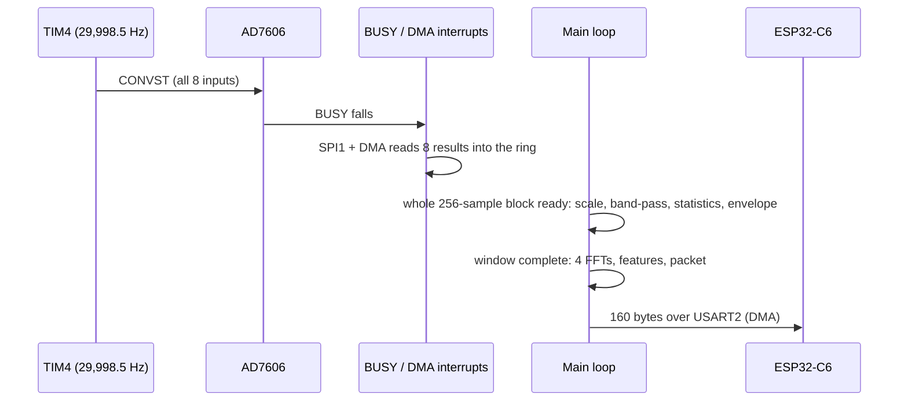

# COE Processing Pipeline Component Details

*Status as of 5 November 2026: implemented on the STM32H755 Cortex-M7 and verified on the board.*

## Purpose

This document explains what each STM32 processing component does, what it receives, and what it produces. The architecture summary is in [COE Edge Acquisition & Processing Node](COE%20Edge%20Acquisition%20%26%20Processing%20Node%20layer.md).

The pipeline:

- Acquires four acceleration signals together at 30 kS/s per channel.
- Divides them into 20-revolution windows at the configured speed.
- Produces 32 features per window for the AI model.
- Sends one fixed 160-byte packet per window to the ESP32-C6.

---

## 1. Fixed Design Values

| Item | Value |
| :--- | :--- |
| Active analog inputs | Four accelerometers (B1X, B1Y, B2X, B2Y) on AD7606 AIN2, AIN4, AIN6, AIN8 |
| ADC | AD7606, eight simultaneous inputs, ±5 V range, serial mode |
| AD7606 oversampling | Off, `OS[2:0] = 000` |
| Sample rate | 29,998.5 S/s per channel (TIM4 200 MHz ÷ 6667); DSP coefficients are designed for 30,000 S/s, a 0.005 % difference |
| SPI read clock | 6.25 MHz (20.5 µs per 128-bit read) |
| Operating modes | 1750 RPM and 3600 RPM, set in `live_config.h` |
| Processing block | 256 sample sets (8.53 ms) |
| ADC ring | 16 blocks × 256 sample sets × 8 inputs × 2 bytes = 64 KiB (about 136 ms) |
| Window | 20 revolutions at the nominal speed: 20,571 samples (1750 RPM) or 10,000 samples (3600 RPM) per channel |
| Band-pass | Butterworth order 8, 2–8 kHz |
| Envelope | Rectify → Butterworth order 7 low-pass (350 Hz passband, 1250 Hz stopband) → decimate by 6 → 5 kS/s |
| Spectrum | Hann window of the actual length, zero-padded to a 4096-point real FFT; 1.2207 Hz bins |
| Features | Eight per channel, 32 in total, all Float32 |
| Bearing orders (profile 1, provisional) | FTF 0.38, BSF 1.98, BPFO 3.05, BPFI 4.95; band ±0.10 order |
| Packet | 160 bytes: marker, metadata, 32 features, CRC-32 |
| UART | USART2, 115200 8N1, DMA; 13.9 ms per packet |

---

## 2. Hardware Before the Software Pipeline

```text
Four TE 805-0050 IEPE accelerometers (100 mV/g)
  -> SRD-1104 IEPE conditioner (about 4 mA from 24 V)
  -> four-channel 2nd-order Sallen-Key low-pass filter (about 11 kHz)
  -> AD7606 AIN2, AIN4, AIN6, AIN8
     (built-in analog input filter; oversampling off)
```

Measured response of the filter plus ADC: −1.6 dB at 8 kHz and −3.0 dB at 10 kHz. See [LPF Design Details](LPF-design-details.md).

| AD7606 input | Serial slot | Pipeline channel |
| :---: | :---: | :--- |
| AIN2 | 1 | B1X, bearing 1 X |
| AIN4 | 3 | B1Y, bearing 1 Y |
| AIN6 | 5 | B2X, bearing 2 X |
| AIN8 | 7 | B2Y, bearing 2 Y |

The AD7606 always delivers all eight results; slots 0, 2, 4 and 6 are read and ignored.

---

## 3. From Samples to Windows

The 256-sample blocks are only containers for moving data through memory. They are not AI windows. A window does not have to start or end on a block boundary: the pipeline accepts any block size and splits a block where a window ends.

The raw samples are never collected into one large window buffer. Each block is processed as it arrives, and only these values belong to the current window:

| Component | During the window | At the window end |
| :--- | :--- | :--- |
| 1. Acquisition | Fills the ring by DMA | – |
| 2. Scaling | Converts each block to g | – |
| 3. Band-pass | Filters each block | – |
| 4. Time features | Running sums of the band-pass signal | RMS, kurtosis, crest factor |
| 5. Envelope | Appends 1 sample in 6 to the envelope record | Complete envelope record |
| 6. Envelope spectrum | – | One PSD per channel |
| 7. Frequency features | – | Envelope RMS and four band RMS values per channel |
| 8. Packet | – | One 160-byte packet sent to the ESP32 |

---

## 4. Firmware Structure and Runtime

```text
CM7/App/
  acquisition/    AD7606 driver, start-up self-test, LIVE stream
  pipeline/       window coordinator: pipeline_process_block(), window callback
  dsp/            bandpass, time_features, envelope, envelope_spectrum, frequency_features
  payload/        32-feature vector and 160-byte packet
  communication/  USART2 DMA sender
  config/         pipeline_config.h (rates, sizes), live_config.h (RPM, profile, volts per g)
```



- The interrupts only move data. No DSP runs inside an interrupt.
- The main loop takes whole blocks from the ring. At a window end it runs the four FFTs and the final features. The longest such call was 10.7 ms; the 136 ms ring keeps acquiring meanwhile, so no samples are lost.
- The window callback copies the features into a packet and queues it for the UART. A full queue is reported and never overwrites a waiting packet.
- Any acquisition error (missed conversion, read overlap, ring overrun, DMA or SPI error) drops the affected blocks and restarts the stream. Window IDs then start again at 1.

The firmware has three modes: **REPLAY** runs every DSP stage on recorded data and compares it with Python reference results; **LIVE_RAW** runs only the ADC and reports raw values, rate and error counters; **LIVE** is the complete system.

---

# Component 1: Acquisition

## Operation

1. At start, a self-test resets the AD7606, checks that BUSY answers a test conversion (rise under 100 ns, fall after about 4 µs), checks for shorted or floating control lines, and confirms serial mode. Acquisition starts only if it passes.
2. TIM4 drives CONVST A and B at 29,998.5 Hz.
3. When BUSY falls, the highest-priority interrupt lowers CS and starts an SPI1 receive by DMA of the eight 16-bit results (20.5 µs at 6.25 MHz).
4. The DMA-complete interrupt raises CS and publishes the sample set in the ring.
5. Every second the firmware reports the measured rate and the error counters.

## Timing per sample

> 33.33 µs period = about 4.15 µs conversion + 20.5 µs read + about 8 µs spare

## Output

Blocks of 256 sample sets, each with eight int16 results, of which slots 1, 3, 5 and 7 are used.

---

# Component 2: Scaling to g

For every used slot:

> acceleration (g) = counts × (10 V ÷ 65,536) ÷ volts-per-g

The sensitivity is set per channel in `live_config.h`: 0.100 V/g, the TE 805-0050 nominal value, assuming the conditioner and filter gains are 1 (the filter gain was measured at 1.000 at 100 Hz). While any channel's sensitivity is 0 (unknown), the pipeline still runs on volts for testing, but no packets are sent, because every packet declares g.

## Output

Four Float32 streams in g, in the order B1X, B1Y, B2X, B2Y.

---

# Component 3: Bearing-Resonance Band-Pass Filter

## Purpose

A bearing defect causes repeated impacts. They excite a high-frequency resonance of the bearing, housing and sensor mounting. The band-pass keeps that region and removes shaft-speed vibration and other low-frequency content.

## Operation

- Butterworth order 8 (four second-order sections), 2–8 kHz, causal, at 30 kS/s (CMSIS-DSP, transposed direct form II).
- The filter state carries across blocks and windows; it is not reset per block.

The 2–8 kHz band is the project's starting value for the installed assembly, not a universal band for every bearing. If measured vibration or a kurtogram shows a more impulsive band, only the coefficients change. This follows Randall and Antoni: the demodulation band must be chosen for the installed case, and spectral kurtosis can locate it ([Randall and Antoni, 2011](https://doi.org/10.1016/j.ymssp.2010.07.017)).

## Output

Four band-passed streams, used by Components 4 and 5.

---

# Component 4: Time Features

While each block passes through, running sums of the band-pass signal are updated in double precision. At the window end:

| Feature | Definition |
| :--- | :--- |
| RMS | √(mean of x²), no mean removal (the band-pass already removes DC) |
| Kurtosis | Pearson kurtosis, m₄ ÷ m₂², with centred moments; Gaussian noise gives 3 |
| Crest factor | max \|x\| ÷ RMS |

Checks on the board: a still sensor gives kurtosis about 3; a 5 kHz sine gives kurtosis 1.50 and crest factor 1.42 (theory 1.5 and √2).

---

# Component 5: Envelope

1. **Rectify:** the absolute value of each band-pass sample.
2. **Low-pass:** Butterworth order 7, flat within 0.1 dB up to 350 Hz and at least 60 dB down from 1250 Hz. It removes the ripple left by rectification and protects the next step from aliasing.
3. **Decimate:** keep one sample in six, 30 kS/s → 5 kS/s (new Nyquist 2.5 kHz, above the 1250 Hz stopband).
4. Append the sample to the window's envelope record.

Filter and decimation states carry across blocks and windows.

| Speed | Envelope samples per channel |
| :---: | :---: |
| 1750 RPM | 3,429 |
| 3600 RPM | 1,667 |

Four records of up to 3,429 Float32 values take about 55 KB.

---

# Component 6: Envelope Spectrum

At the window end, for each channel:

1. Remove the envelope's mean.
2. Apply a periodic Hann window of the record's actual length.
3. Zero-pad to 4096 values.
4. Compute a 4096-point real FFT (CMSIS-DSP).
5. Form the one-sided power spectral density, with bins every 5000 ÷ 4096 = 1.2207 Hz.

A bin's shaft order is `frequency ÷ (RPM ÷ 60)`. A 20-revolution record has a physical resolution of 1/20 = 0.05 order; zero-padding only gives a denser, fixed-size grid.

The board FFT matched the Python reference over all 2049 bins (maximum amplitude error 3.7 × 10⁻⁶ g).

---

# Component 7: Frequency Features

Per channel:

- **Envelope RMS**, using the envelope samples before mean removal.
- **Four band RMS values**, one per bearing family. For each family, the band covers ±0.10 order around its order, converted to hertz with the window's RPM. Its value is the RMS of the PSD bins whose centres lie in the band:

> band RMS = √(Σ PSD × 5000 ÷ 4096)

| Family | Order | At 1750 RPM | At 3600 RPM |
| :--- | :---: | :---: | :---: |
| FTF | 0.38 | 11.1 Hz | 22.8 Hz |
| BSF | 1.98 | 57.8 Hz | 118.8 Hz |
| BPFO | 3.05 | 89.0 Hz | 183.0 Hz |
| BPFI | 4.95 | 144.4 Hz | 297.0 Hz |

These are the orders of bearing profile 1 (project, provisional). Profile 2 holds the CWRU drive-end orders (0.39828, 2.35675, 3.5848, 5.4152) for testing with public data. A profile is rejected if its bands overlap or lie above the envelope passband.

## Feature order

```text
Per channel: 0 RMS, 1 kurtosis, 2 crest factor, 3 envelope RMS,
             4 FTF, 5 BSF, 6 BPFO, 7 BPFI
features[0..7]   = B1X
features[8..15]  = B1Y
features[16..23] = B2X
features[24..31] = B2Y
```

The STM32 firmware, stored training data, AI training and inference code, and dashboard labels must all use this order, these units (g) and the same normalization.

A constant or zero channel gets zero features and a cleared validity bit. That is "no data", not a healthy-bearing label.

---

# Component 8: Packet and Sending

| Bytes | Field |
| :---: | :--- |
| 0–3 | `COE1` |
| 4–5 / 6–7 | Schema 1 / feature count 32 |
| 8–11 | Window ID |
| 12–15 | Nominal RPM |
| 16–19 | Bearing profile ID |
| 20–23 | Channel-valid mask |
| 24–27 | Unit ID, 1 = g |
| 28–155 | 32 Float32 features |
| 156–159 | CRC-32 (zlib) of bytes 0–155 |

All values are little-endian. USART2 sends the packet by DMA in 13.9 ms. The ESP32-C6 checks the CRC, schema and values, then forwards the 32 features as HTTP POST JSON over the local Wi-Fi. It does not recalculate them.

## Processing deadline (S2)

The S2 timer starts at a window's last sample and stops when its features are complete. Most work happens while the samples arrive; after the window ends, only the four FFTs, the final features and the packet remain.

| Test | Result | Limit |
| :--- | :--- | :--- |
| Recorded data, 1750 RPM | 91.0 ms | 333 ms |
| Recorded data, 3600 RPM | 47.9 ms | 333 ms |
| Live with sensors, 156 windows at 1750 RPM | typically 10–11 ms, worst 16.1 ms | 333 ms |

---

## 5. Worked Example at 3600 RPM

- 3600 RPM = 60 revolutions per second, so 20 revolutions take 333.3 ms.
- At 30 kS/s each channel produces 10,000 samples: 39 full blocks of 256 plus 16 samples. The window therefore ends inside a block; the pipeline splits that block, and the rest starts the next window.
- During the window, every block is scaled to g, band-passed, added to the running statistics, rectified, low-passed and decimated. About 1,667 envelope samples per channel accumulate.
- At the last sample, the pipeline finishes RMS, kurtosis and crest factor, runs four 4096-point FFTs on the zero-padded envelopes, computes the envelope RMS and the four band RMS values, and builds the 160-byte packet.
- The packet takes 13.9 ms on the UART; the ESP32-C6 forwards it to the host, where the AI makes one prediction for the window.

At 1750 RPM the same steps cover 685.7 ms, 20,571 samples and 3,429 envelope samples per channel, and produce the same 32 features in the same packet.

---

## 6. Verification Performed

| Check | Result |
| :--- | :--- |
| Time features, 48 channel-windows | Passed against Python |
| Band-pass, 16 runs | Passed |
| Envelope, 16 runs + 4 windows | Passed |
| FFT, all 2049 bins, 9 records | Passed, maximum error 3.7 × 10⁻⁶ g |
| Frequency features, 18 cases | Passed |
| Streaming vs batch pipeline, 12 + 12 windows | Passed |
| Packet and decoder, 22 cases + exact bytes | Passed |
| Live sample rate and loss | 29,998.5 S/s, 0 lost |
| Live window timing | 156/156 windows, worst 16.1 ms |

Tolerances: 2 × 10⁻⁵ × (1 + \|ref\|) for time features and 4 × 10⁻⁵ × (1 + \|ref\|) for envelope and frequency features.

---

## 7. Remaining Items

1. Verify live packets at the ESP32 and the host; run LIVE for 10 minutes or more with delivery.
2. Confirm the real bearing's orders (profile 1 is provisional) and the rig speed before AI training.
3. Refine the 2–8 kHz band only if measured vibration shows a stronger impulsive band.
4. Check calibration against a known vibration.

## 8. Optional Future Work

These are not part of the built pipeline and are not committed:

- **Keyphasor windowing:** capture one pulse per revolution, measure the RPM of each window and end windows on exact revolutions, instead of the nominal sample count.
- **Synchronous 1x displacement:** two RK4 proximity probes on spare AD7606 inputs; per revolution, update running sine and cosine sums at 1 order; at the window end, give the peak amplitude (µm) and phase (rad) per probe for the FE twin, adding four Float32 values to the packet.
- **Angular resampling:** resample the envelope at equal shaft angles before the FFT, only if speed changes inside a window smear the order peaks. It needs the Keyphasor.
