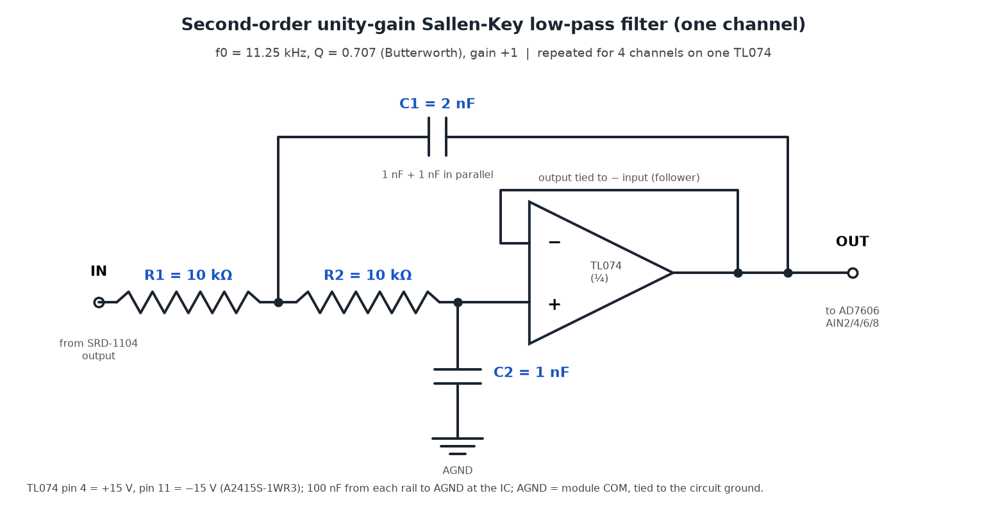
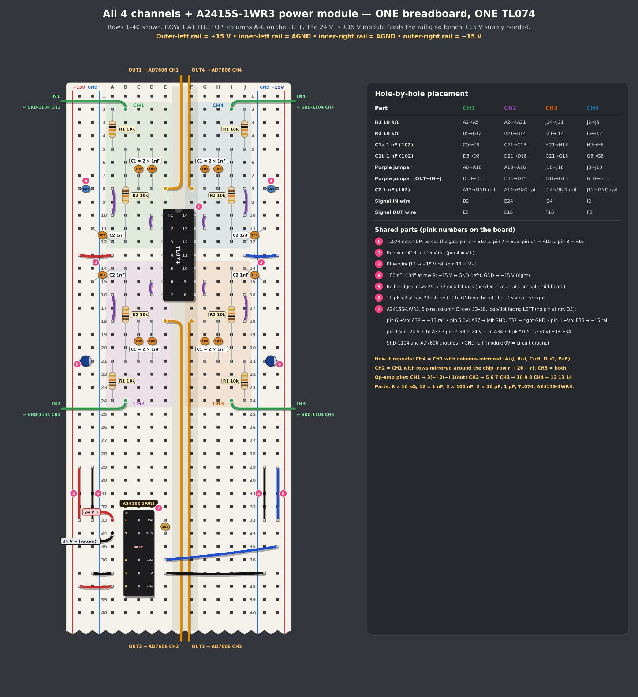
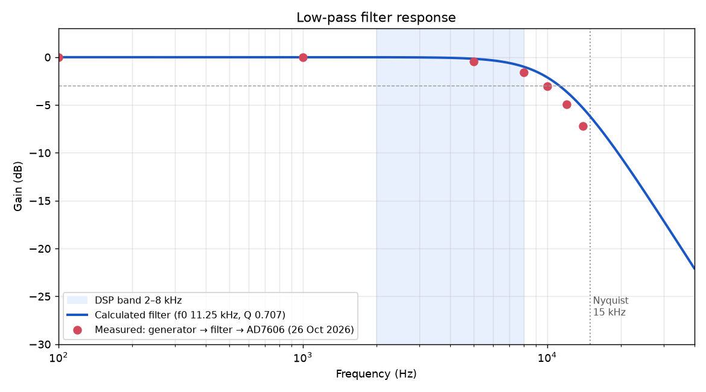

# Second-Order Unity-Gain Sallen-Key Low-Pass Filter

## Design objective

This document records the analog anti-aliasing filter placed between one SRD-1104 output channel and one AD7606 analog input. The same filter is built four times, one per accelerometer channel, using the four op-amps of a single TL074.

| Parameter | Value |
|---|---:|
| Filter response | Butterworth low-pass |
| Filter order | Second order |
| Natural (−3 dB) frequency, $f_0$ | 11.25 kHz (calculated) |
| Quality factor, $Q$ | 0.707 |
| Passband gain | Unity, $+1\ \mathrm{V/V}$ (non-inverting) |
| Topology | Unity-gain Sallen-Key, op-amp as a voltage follower |
| Op-amp | TL074 (one IC, four channels) |
| Op-amp supply | $+15\ \mathrm{V}$, AGND, $-15\ \mathrm{V}$ from an A2415S-1WR3 isolated module |
| Input and output | Bipolar, single-ended |

**Design change.** The first design was a fourth-order MFB filter (two cascaded inverting stages per channel, two TL074 ICs). The built and tested filter is the second-order Sallen-Key below: one stage per channel, so one TL074 serves all four channels on one breadboard. The earlier design remains in the repository history.

## Circuit

- $R_1$ connects the input to node A.
- $R_2$ connects node A to the non-inverting input (node B).
- $C_1$ connects node A to the op-amp output (the feedback capacitor).
- $C_2$ connects node B to AGND.
- The output is tied directly to the inverting input, so the op-amp is a voltage follower with a gain of exactly +1.

Breadboard layout of all four channels, the TL074 and the ±15 V module:

## 1. Transfer function

For the unity-gain Sallen-Key low-pass stage:

$$
H(s)=\frac{1}{s^2R_1R_2C_1C_2+s\,C_2(R_1+R_2)+1}
$$

Comparing it with the standard second-order form $\dfrac{\omega_0^2}{s^2+\frac{\omega_0}{Q}s+\omega_0^2}$ gives:

$$
\omega_0=\frac{1}{\sqrt{R_1R_2C_1C_2}}
\qquad
Q=\frac{\sqrt{R_1R_2C_1C_2}}{C_2(R_1+R_2)}
$$

The DC gain is $H(0)=+1$ for any component values, because the follower sets the gain.

## 2. Equal-resistor design

Choosing $R_1=R_2=R$ simplifies the equations to:

$$
\omega_0=\frac{1}{R\sqrt{C_1C_2}}
\qquad
Q=\frac{1}{2}\sqrt{\frac{C_1}{C_2}}
$$

A Butterworth (maximally flat) response needs $Q=1/\sqrt{2}=0.707$, therefore:

$$
\sqrt{\frac{C_1}{C_2}}=\sqrt{2}
\quad\Rightarrow\quad
\boxed{C_1=2\,C_2}
$$

This ratio is built from identical parts: $C_2=1\ \mathrm{nF}$ and $C_1=1\ \mathrm{nF}+1\ \mathrm{nF}$ in parallel $=2\ \mathrm{nF}$.

## 3. Component values and natural frequency

With $R=10\ \mathrm{k\Omega}$, $C_1=2\ \mathrm{nF}$ and $C_2=1\ \mathrm{nF}$:

$$
\sqrt{C_1C_2}=\sqrt{(2\times10^{-9})(1\times10^{-9})}=1.414\ \mathrm{nF}
$$

$$
f_0=\frac{1}{2\pi(10{,}000)(1.414\times10^{-9})}
=\boxed{11.25\ \mathrm{kHz}}
$$

$$
Q=\frac{1}{2}\sqrt{\frac{2\ \mathrm{nF}}{1\ \mathrm{nF}}}=\boxed{0.707}
$$

For a Butterworth second-order filter the −3 dB frequency equals $f_0$, and the gain is $|H(f)|=1/\sqrt{1+(f/f_0)^4}$.

| Component (per channel) | Value | Built from |
|---|---:|---|
| $R_1$ | 10 kΩ | one 10 kΩ |
| $R_2$ | 10 kΩ | one 10 kΩ |
| $C_1$ | 2 nF | two 1 nF ("102") in parallel |
| $C_2$ | 1 nF | one 1 nF ("102") |
| Op-amp | ¼ TL074 | follower |

## 4. Calculated and measured response

| Frequency | Calculated filter gain | Measured, filter + AD7606 |
|---:|---:|---:|
| 100 Hz | 0.00 dB | 0.00 dB |
| 1 kHz | 0.00 dB | −0.02 dB |
| 2 kHz | 0.00 dB | – |
| 5 kHz | −0.17 dB | −0.44 dB |
| 8 kHz | −0.99 dB | −1.59 dB |
| 10 kHz | −2.10 dB | **−3.02 dB** |
| 11.25 kHz | −3.01 dB | – |
| 12 kHz | – | −4.95 dB |
| 14 kHz | −5.31 dB | −7.19 dB |
| 20 kHz | −10.4 dB | not yet measured |
| 25 kHz | −14.0 dB | not yet measured |

The measurement (26 October 2026) used a 1 V peak-to-peak sine from a FNIRSI 2C53T generator into filter input 1, with filter output 1 connected to all four ADC inputs and the STM32 recording the raw samples. The measured points include the AD7606's own built-in analog input filter, which is why they sit slightly below the calculated filter curve. Fitting "second-order filter × first-order 15 kHz roll-off" to the seven points gives a built filter of $f_0=11.6\ \mathrm{kHz}$ and $Q=0.75$, within 0.01 dB of every point, so the built filter matches its design within normal component tolerance. All four ADC inputs agreed within about 1 mV, and no distortion or oscillation was seen.

Inside the 2–8 kHz band used by the DSP, the complete analog path loses at most 1.6 dB (gain 0.83 at 8 kHz). This fixed shape can be corrected later by calibration if absolute levels near 8 kHz matter.

## 5. Anti-aliasing performance

The ADC samples at 29,998.5 S/s, so the Nyquist frequency is about 15 kHz. An input at frequency $f$ above Nyquist appears at $|f-30\ \mathrm{kHz}|$. Inputs between 22 and 28 kHz therefore fold into the 2–8 kHz analysis band.

| Input | Appears at | Calculated filter attenuation |
|---:|---:|---:|
| 22 kHz | 8 kHz | 11.9 dB |
| 25 kHz | 5 kHz | 14.0 dB |
| 28 kHz | 2 kHz | 16.0 dB |
| 34 kHz (805 sensor resonance) | 4 kHz | 19.3 dB |

The AD7606's internal filter adds some attenuation on top of these values. A second-order filter gives modest protection: it is adequate while little vibration energy exists above 20 kHz, but strong high-frequency content, such as an excited sensor resonance, could leak into the band. The 20–28 kHz response has not been measured yet. If aliasing appears in tests, a second stage (fourth order) or a lower cutoff can be added without changing the firmware.

## 6. Four-channel implementation

| Filter channel | TL074 pins (+ in, − in, out) | AD7606 input | Pipeline channel |
|---|---|---|---|
| 1 | 3, 2, 1 | AIN2 | B1X |
| 2 | 5, 6, 7 | AIN4 | B1Y |
| 3 | 10, 9, 8 | AIN6 | B2X |
| 4 | 12, 13, 14 | AIN8 | B2Y |

- TL074 pin 4 = +15 V and pin 11 = −15 V.
- One 100 nF capacitor from +15 V to AGND and one from −15 V to AGND, next to the IC.
- Two 10 µF bulk capacitors at the rails (+15 V to AGND, AGND to −15 V).
- One 1 µF capacitor across the A2415S-1WR3 input (24 V to its input ground).
- A2415S-1WR3 pins: 1 = +Vin (24 V), 2 = −Vin (24 V return), 4 = −Vo (−15 V rail), 5 = 0 V (AGND rails), 6 = +Vo (+15 V rail).

**Grounding rule.** The A2415S-1WR3 is isolated: its 0 V output is not connected to its input side. Its 0 V (the AGND rails) must be connected to the circuit ground shared by the SRD-1104 and the AD7606. On 2 November 2026 this link was missing: the filter outputs drifted by volts, and two channels moved as mirror images. One jumper from the AGND rail to the 24 V return fixed it. Afterwards the quiet noise was 0.3 mV RMS on every channel.

Parts for all four channels: 8 × 10 kΩ, 12 × 1 nF, 2 × 100 nF, 2 × 10 µF, 1 × 1 µF, 1 × TL074, 1 × A2415S-1WR3.

## 7. Validation status

| Check | Status |
|---|---|
| Passband gain 1.000 at 100 Hz | Measured |
| −3 dB point (with the AD7606 filter) at 10 kHz | Measured |
| Four channels identical | Measured, within about 1 mV |
| Stable, no oscillation or distortion | Measured, sine fits with a few mV error |
| Quiet noise with sensors connected | 0.3 mV RMS per channel (2 November 2026) |
| Attenuation at 20–28 kHz | Not yet measured |

C0G/NP0 capacitors are preferred for a final soldered version. With general-purpose 1 nF parts, matching them between channels keeps the four responses equal.

## Reference

- Texas Instruments, [*Analysis of the Sallen-Key Architecture*, SLOA024](https://www.ti.com/lit/an/sloa024b/sloa024b.pdf).
