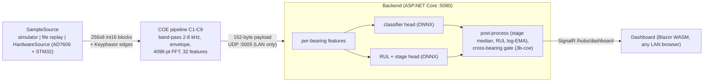

# Real-Time Edge Digital Twin for Bearing Fault Diagnosis and RUL Prediction in OH-2 Centrifugal Pumps

KFUPM Senior Design II (ICS414), Team M001 (COE, ICS, ME). A sensor node near the pump streams 152-byte
feature payloads over the LAN to a backend that classifies the bearing fault, estimates remaining useful life
(RUL), and pushes the result to a web dashboard. Branch `feature/up2-prototype` is the **Update Presentation 2 (UP2)**
prototype; the earlier PPR prototype (2026-10-05) is kept at the end as history.

> **Data statement.** The hardware (AD7606 + IEPE accelerometers + STM32/ESP32-C6 node) is not ready, so **no data from
> the team rig exists**. All UP2 ML results are on **synthetic** (`aiengine/synth_v3`) or **simulated** (COE rig
> simulator) data, a substitute **approved by the coach**. A synthetic score shows the pipeline works on data of this
> shape; it is not evidence about real bearings. Public datasets (XJTU-SY, IMS, MaFaulDa) are **not in the repo**
> (git-ignored, `AI-engine/data/`); the PPR numbers measured on them stay as history. Every number carries a tag:
> `[SYNTHETIC]` `[SIMULATION]` `[MEASURED host]` `[MEASURED on <dataset>]` `[CALCULATED]`.

## Architecture and the hardware-ready boundary



Everything left of the 152-byte payload is replaceable: on hardware day only the sender changes
(see [`AI-engine/aiengine/coe/README.md`](AI-engine/aiengine/coe/README.md)). Without a sender, the backend replays a payload stream
(`up2` = synthetic healthy -> fault -> failure; the PPR sources `demo`, `twin-sim`, `synthetic` still exist).
Details: [`INTEGRATION.md`](INTEGRATION.md), [`src/DigitalTwin.Backend/README.md`](src/DigitalTwin.Backend/README.md).

## Model versions

| Version | Data | Heads | Status | Contract |
|---|---|---|---|---|
| v2 | public datasets (XJTU-SY, IMS, MaFaulDa) | TFT + N-HiTS (ONNX) | PPR, historical; fails S7/IS3 on public data | `model_contract.json` |
| v3 | `[SYNTHETIC]` synth_v3 | gradient-boosted heads | superseded (S7 15.53 %, stage max 2 on its test set) | `model_contract_v3.json` (`_v3_nn` = TFT + N-HiTS on synth_v3) |
| **v3b** | `[SYNTHETIC]` synth_v3 (+ train2/train3) | gradient-boosted heads (XGBoost/LightGBM -> ONNX) in the classifier / RUL slots, plus a C#-portable post-process | **deployed for UP2** (default Docker backend) | `model_contract_v3b.json` |
| v3c | `[SYNTHETIC]` | v3b + physics prior into the RUL head | research artifact, **not deployed** (9.5 MB, not ported to C#) | `model_contract_v3c.json` |
| v3b_coe | `[SIMULATION]` COE-pipeline windows + synth_v3 | v3b classifier retrained on COE-pipeline windows + cross-bearing gate; stage/RUL heads unchanged and not usable on COE features | demo contract for COE-simulator sources | `model_contract_v3b_coe.json` |

The spec names N-HiTS/TFT; the change to gradient-boosted heads was approved for performance, and the N-HiTS/TFT results on the same
data are kept in the evidence for transparency.

## UP2 results

Sources: [`evidence/UP2_Evidence.md`](evidence/UP2_Evidence.md) (coach summary, recomputed by `AI-engine/notebooks/UP2_Evidence.ipynb`, HTML copy beside it)
and `AI-engine/reports/up2_spec_check_20261024T114947Z.md`. Headline numbers are from the fresh test set `synth_v3_test2`
(100 runs, registered before the v3b fit, scored once). The full table of the 17 counted items is the notebook's master table.

| Item | Target | Value | Tag | Status |
|---|---|---|---|---|
| S7 RUL MAPE | <= 15 % | 12.64 % (v3b); second fresh set test3 10.75 %; original N-HiTS 46.9 % (worse) | `[SYNTHETIC]` | MET on synthetic; **public data still fails (281.8 %)** |
| S8 inference per window, p95 | < 200 ms | 0.35 ms (canonical: classifier ONNX, 1 thread, batch 1); TFT 1.54 ms | `[MEASURED host]` | MET; re-measure on the chosen server |
| IS3a macro-F1 | >= 0.85 | 0.959 (original TFT 0.924) | `[SYNTHETIC]` | MET on synthetic |
| IS3b stage error | <= 1 | max 1 (original TFT max 3) | `[SYNTHETIC]` | MET on synthetic |
| IS3c fault caught by stage 3 | all | 80 / 80 | `[SYNTHETIC]` | MET on synthetic |
| IS1 end-to-end | < 500 ms | p95 ~98 ms incl. simulated 10-60 ms Wi-Fi hop and calculated 28.4 ms STM32 leg; breaks only if the real hop > ~458 ms | `[MEASURED host]` `[CALCULATED]` `[SIMULATION]` | MET at design level (hop and STM32 leg not measured) |
| S9 dashboard rate | >= 10 Hz | new data at the 10 Hz replay rate (client count ~30 Hz is a 50 ms re-broadcast timer); browser render not measured | `[MEASURED host]` | MET (rank 6) |
| S4 / S5 (COE) | 30 kS/s x 4 ch; payload <= 333 ms | gap-free with 16.3 us slack per sample set; STM32 estimate 28.4 ms | `[CALCULATED]` `[SIMULATION]` | MET at design level (rank 3) |
| S6 fixed AI input | 1000-3600 rpm | 28 speeds, always 32 features / 152 bytes; below ~1465 rpm the envelope is truncated to the 4096-pt FFT (open COE question) | `[SIMULATION]` | MET (simulation) |
| C4 no cloud / C5 LAN only | - | engine runs with network calls blocked; guard tests pass | `[MEASURED host]` | MET |
| COE domain gap (readiness, adds no MET item) | - | v3b on COE windows macro-F1 0.584; v3b_coe 0.875 (bearing-2 false-fault 0.6 %, missed-fault 22.8 %); stage/RUL heads unreliable on COE features | `[SIMULATION]` | adapted classifier only |
| IS2 physics-AI residual | see reworded spec | IS2: see evidence/UP2_Evidence.md | `[SIMULATION]` `[SYNTHETIC]` | **PENDING the reworded spec**; the literal max <= 5 % is NOT MET (v3c attempt: max 245.6 %, median 33.4 %) and must not be presented as met |
| C1, C2, C6, S1, S2, S3 | - | evidence to be supplied by the ME/COE owners | - | not counted |

Count in the evidence file: 10 of 17 counted items MET (7 firm, 3 at design level); the bar is more than 75 % (13), so it is not reached yet. C3 (BOM) was excluded by the reviewer.
Honest limits: the healthy-companion bearing sits at stage 2 in 99.8 % of windows; v3b misclassifies bearing 2 on COE-simulator data
(hence v3b_coe); real Wi-Fi hop, STM32 timing and laptop-vs-Pi-5 latency are unmeasured.

## Quick start with Docker (needs Docker only)

```bash
docker compose build                                       # default services (backend)
docker compose up -d backend                               # v3b contract + up2 synthetic replay -> http://localhost:5080/ (UDP 5005 for a node)
curl http://localhost:5080/api/health ; curl http://localhost:5080/api/state ; docker compose down

docker compose --profile coe up -d backend-coe coe-sim     # COE pipeline simulator -> UDP -> backend (v3b_coe contract) -> http://localhost:5081/
                                                           # ~2 min: bearing 1 develops an outer-race fault, bearing 2 stays healthy
docker compose --profile coe down
docker compose --profile ai run --rm ai-engine             # selftest
docker compose --profile ai run --rm ai-engine python -m aiengine.up2_eval   # re-score saved predictions + latency
docker compose --profile test run --rm test                # pytest: tests/coe up2 up2c coe_adapt twin_up2
docker compose --profile test run --rm test-dotnet         # dotnet test: backend + twin
docker compose --profile evidence run --rm evidence        # executes UP2_Evidence.ipynb headless -> ./artifacts/evidence/UP2_Evidence.html
docker compose --profile notebook up notebook              # Jupyter on http://localhost:8888/ (127.0.0.1), opens UP2_Evidence.ipynb
```

Profiles: default `backend`; `coe` = `backend-coe` (host 5081, UDP 5006) + `coe-sim` (`DT_COE_RATE` windows/s, default 2); `ai`; `test` (`test`, `test-dotnet`);
`evidence`; `notebook`. Env overrides on `backend`: `DT_CONTRACT`, `DT_SOURCE` (`up2|demo|twin-sim|synthetic`), `DT_RATE_HZ`, `DT_REPLAY`, `DT_PHYSICS`.
PPR behaviour: `DT_CONTRACT=AI-engine/models/model_contract.json DT_SOURCE=demo docker compose up -d backend`.
The git-ignored datasets are mounted read-only from `AI-engine/data/`; evidence-notebook cells that need public data or the dotnet SDK report `missing`
instead of crashing (inside Docker the dotnet-based cells are `missing`; run them natively, or use `test-dotnet`). The evidence run copies its regenerated `evidence/`
to `artifacts/evidence/evidence_regenerated/` and never overwrites the committed files.

**C5 (LAN only):** `5080:5080` publishes on every host interface. Put your LAN address in front in `docker-compose.yml`
(`"192.168.1.50:5080:5080/tcp"`, same for UDP 5005) to bind one interface. The backend also returns 403 to non-private client addresses (UDP: dropped and counted),
but Docker Desktop NATs, so the guard then sees the Docker gateway address.

## Quick start without Docker

```powershell
# Python (CPU torch); AI-engine/.venv is gitignored
cd AI-engine
python -m venv .venv ; .venv/Scripts/pip install torch --index-url https://download.pytorch.org/whl/cpu ; .venv/Scripts/pip install -r requirements.txt
.venv/Scripts/python.exe app.py selftest
.venv/Scripts/python.exe -m pytest tests -q
# .NET 10 SDK
dotnet test tests/DigitalTwin.Backend.Tests -c Release
```

## Demo scripts (native, PowerShell)

| Script | What it runs |
|---|---|
| `./scripts/run-up2-demo.ps1` | backend, v3b contract, `up2` synthetic replay (healthy -> fault -> failure); dashboard at `http://localhost:5080/` |
| `./scripts/run-up2-coe-demo.ps1` | backend (v3b_coe contract, replay off) + COE simulator through the real pipeline and UDP (`scripts/coe_fault_scenario.py`) |
| `./scripts/run-demo.ps1 [-Mode twin-sim]` | PPR demo (v2 contract, public-data replay or twin simulation) |
| `./scripts/run-demo.sh [mode] [rateHz] [bind] [port]` | same on Linux/macOS |

Add `-Bind <LAN IP>` to bind one interface.

## Hardware-day swap

1. Firmware implements COE components C1-C9 (STM32 runs the pipeline, sends the 152-byte payload via UART -> ESP32-C6 -> Wi-Fi -> UDP 5005); `aiengine/coe` is the golden reference.
2. Cross-check: record raw blocks (`record_blocks`), replay with `CoePipeline(FileReplaySource(file))`, compare features with the firmware payload for the same window.
3. Stop the simulator, power the node, point it at `<server>:5005`. Nothing downstream changes.
4. Re-fit on first rig data: `tau` of the cross-bearing gate, the stage cut, the classifier with seeded faults; the stage/RUL heads need run-to-failure data.
5. Measure the real Wi-Fi hop, STM32 leg and server (laptop or Raspberry Pi 5) latency.

Full steps and assumptions: [`AI-engine/aiengine/coe/README.md`](AI-engine/aiengine/coe/README.md).

## Repository layout

| Path | Contents | Owner |
|---|---|---|
| `AI-engine/aiengine/coe/` | UP2: COE pipeline as code, sources, UDP sender, verify | COE interface / Jaddoua |
| `AI-engine/aiengine/synth_v3/`, `up2*.py` | synthetic generator; v3/v3b training, scoring, export; v3c research | Jaddoua (ICS) |
| `AI-engine/aiengine/coe_adapt*`, `coe_dataset.py` | COE-domain classifier adaptation + cross-bearing gate | Jaddoua |
| `AI-engine/models/` | v2, v3, v3b, v3c, v3b_coe ONNX + contracts + golden vectors + demo payloads | Jaddoua |
| `AI-engine/notebooks/` | `UP2_Evidence.ipynb/.html` (live scorecard), `PPR_ICS_Evidence` (history) | Jaddoua |
| `AI-engine/reports/`, `evidence/` | stored spec checks, integration measurements, screenshots, `UP2_Evidence.md` | Jaddoua |
| `src/DigitalTwin.Backend/`, `src/DigitalTwin.Twin/` | ingest, ONNX inference, SignalR, LAN guard; C# beam twin | integration |
| `src/DigitalTwin.Dashboard/` | Blazor WASM dashboard + 3D viewer | **Mussab (ICS)**, do not edit without him |
| `tests/`, `tools/DemoMeasure/` | backend and twin tests; latency/rate client | integration |
| `docker/`, `docker-compose.yml`, `scripts/` | containers, profiles, demo scripts | integration |
| `AI-test/` | HISTORICAL earlier synthetic-only testbench | - |
| `Project architecture/` | specs and design docs per discipline | team |

Branches: `feature/*` -> `dev` -> `stage` -> `main`. UP2 work is on `feature/up2-prototype` (cut from `feature/integration`); `feature/dashboard` is Mussab's, never commit to it.

## Presenter checklist (UP2)

Before: Docker Desktop running; `docker compose build` done while online; ports 5080/5081/5005 free; or native: .NET 10 SDK, `AI-engine/.venv`, a Release build.

1. State the data basis first: synthetic/simulated, coach-approved substitute; no rig data yet.
2. `docker compose up -d backend` (or `run-up2-demo.ps1`): the dashboard shows healthy -> fault -> failure; the header says SYNTHETIC / SIMULATED SOURCE. The numbers behind it are in the notebook.
3. `docker compose --profile coe up -d backend-coe coe-sim` (or `run-up2-coe-demo.ps1`): raw samples -> COE pipeline -> 152-byte payload -> UDP -> backend; bearing 1 faults, bearing 2 stays healthy. This is the exact boundary a real node replaces. Do not quote its RUL or stage (those heads are not valid on COE features).
4. Open `UP2_Evidence.html` (offline fallback) or Run All in the notebook (about 3-4 min): master table of the counted items with ranks.
5. Limits to say plainly: synthetic scores are not rig evidence; public-data S7/IS3 still fail; the IS1 hop and STM32 leg are assumed/calculated; the healthy bearing shows stage 2; v3c is research only; IS2 is not claimed met under its literal wording; ME/COE owner items are not counted.

---

# Historical: PPR prototype (2026-10-05, public data, v2 models)

Still true as history; superseded for UP2 by the sections above. Everything below was measured on public datasets or the PPR simulation with the v2 contract
(`model_contract.json`), on a dev laptop over loopback. Reproduce with `DT_CONTRACT=AI-engine/models/model_contract.json DT_SOURCE=demo docker compose up -d backend`
and `AI-engine/notebooks/PPR_ICS_Evidence.ipynb`.

### The AI part

### Datasets
Decision of 2026-10-04, see [`ICS External Datasets & Literature Precedent.md`](<Project architecture/ICS/ICS External Datasets & Literature Precedent.md>) section 5.
Every dataset must survive the rig's DSP chain (2-8 kHz band-pass, 20-revolution windows, speeds 1750/3600 rpm).

| Dataset | Used for | Why |
|---|---|---|
| XJTU-SY (15 run-to-failure bearings, 25.6 kHz, 2 axes) | RUL pretraining (primary) | records are 44-51 revolutions; failed element labelled (outer, inner, cage) |
| IMS Test 1 (4 bearings, 20 kHz, 2 axes) | RUL, and the fine-tuning rehearsal | only multi-bearing biaxial run-to-failure set; held out of pretraining |
| MaFaulDa (seeded ball/cage/outer, 737-3686 rpm) | classification | speed sweep covers both rig speeds; bearing orders within 0.11 of the rig's. In the v2 results (the v1 run used XJTU-SY + IMS only). Its test records are contiguous speed blocks of the same rig, and it has no inner-race class |
| FEMTO-ST / PRONOSTIA | rejected | 0.1 s records = 2.5-3 revolutions, a 20-revolution window cannot be formed |
| CWRU | rejected / demoted | single axis per bearing; most files are 12 kHz, which cannot cover the 2-8 kHz band |

### Model unit: one biaxial bearing
Public sets have 1 test bearing (XJTU-SY) to 4 (IMS), the rig has 2, each with two orthogonal axes. So models
see **one bearing's 16 features** (8 from X, 8 from Y); the rig's 32 features are two such records. This also
gives fault localisation per bearing.

### Hybrid model and coupling
- **N-HiTS** forecasts a health index (HI); RUL = time until the forecast crosses a failure threshold.
- **TFT** classifies each window (healthy / outer / inner / ball / cage) from the last 12 windows plus the
  current one; its attention gives the interpretable part.
- **Coupling**: the TFT-predicted class selects the RUL failure threshold. Stage 1-6 comes from the fraction of
  degradation consumed; stage 1 is before a causal onset detector fires (HI > mean + 3 max(sigma, 0.01) for 12
  consecutive windows).

### Pretrain, then fine-tune
`pytorch-forecasting` ships no pretrained weights, so "pretrained" means our own training on public data;
`finetune` adapts it to a new machine. The new-machine rehearsal is IMS (fine-tune on B1-B3, test on B4). It
gave only a small gain (S7 577 % to 469 %, see results). The rig fine-tune has not been done.

### Frozen, bearing-level splits
Split by bearing (run-to-failure) or by group-and-speed block (MaFaulDa), never by window, because neighbouring
windows are near-duplicates. `AI-engine/splits.json` was frozen before any real-data training. Test bearings:
XJTU-SY 1_4 (cage), 2_5 (outer), 3_4 (inner), IMS B4. Model selection uses leave-one-bearing-out on train+val only.

### S7 metric, pre-registered
`AI-engine/DESIGN.md` section 7, written before any test result existed. MAPE is the mean over test bearings of
the mean per-window |RUL_pred - RUL_true| / RUL_true on the degradation window [onset, failure minus the last 10%
of the interval]. Bearing-averaged so long-lived bearings do not dominate. RMSE, PHM-2012 score and full-window
MAPE are reported alongside, never substituted.

### ONNX export and C# parity
TFT and N-HiTS export to ONNX (`AI-engine/models/`, contract in `model_contract.json`). The backend runs them in
process through ONNX Runtime and re-implements the feature, RUL and stage logic in C#.
`golden_vectors.json` (12 cases) is checked by `GoldenParityTests`: engineered rows, TFT tensors, class
probabilities, HI and forecasts identical to printed precision; max relative RUL diff 6.6e-16.

### Key decisions and reasons

| Decision | Reason |
|---|---|
| Per-bearing unit | matches every candidate dataset and gives per-bearing diagnosis |
| Bearing-level splits, frozen early | window-level splits leak; frozen splits stop test-set tuning |
| Causal onset detector | the same rule runs live, so training labels match runtime behaviour |
| Class selects RUL threshold | failure level differs by fault type |
| Pre-registered S7 | MAPE blows up near end of life; the window was fixed before seeing results |
| FEMTO, CWRU dropped | cannot satisfy the rig's window length and band |
| Distributed node + server, LAN only (C5) | the coach wants to monitor from an office; the handheld idea was dropped |

### Results

<!-- RESULTS:BEGIN -->
Source: `AI-engine/reports/latest.md` (run `real_v2`, 20261005T012112Z, seed 20261004), `evidence/integration_measurements_20261005.md`
and `INTEGRATION.md`. Test bearings are public-dataset bearings, never used for training or model selection (the
LOBO row is the one secondary analysis that differs, see its tag).

**Disclosure:** v2 = second look at the XJTU-SY/IMS test bearings; v2 choices made on validation only; v1 kept in `reports/`.
The v2 TFT is trained jointly on XJTU-SY + IMS + MaFaulDa; N-HiTS and the RUL calibration are unchanged from v1.
MaFaulDa test records are contiguous speed blocks of the same rig, and MaFaulDa has no inner-race class.

| Spec | Target | Value | Label | Verdict |
|---|---|---|---|---|
| S7 RUL MAPE (4 test bearings) | <= 15 % | 281.8 % (IMS B4 468.6 %, XJTU 1_4 567.2 %, 2_5 47.3 %, 3_4 44.1 %) | [MEASURED on XJTU-SY/IMS] | FAIL |
| S7 secondary, LOBO over 15 XJTU-SY bearings | <= 15 % | median 73.7 %, mean 221.7 %, 0/15 within target | [MEASURED on XJTU-SY]; secondary analysis, each bearing is held out in its own fold, so it includes test bearings in other folds' training | FAIL |
| S8 TFT latency p95, ONNX, 1 thread | < 200 ms | 11.1 ms | [MEASURED loopback, dev laptop; re-measure on the chosen server] | PASS |
| Hybrid, N-HiTS ONNX inference per window (supporting) | < 200 ms per window | p50 ~0.4, p95 0.6-0.8, max 1.1-2.5 ms across runs (notebook §4b, live) | [MEASURED loopback, dev laptop] | supporting |
| Hybrid, full per window: features + TFT + N-HiTS + RUL, Python reference engine (supporting) | < 200 ms per window | p95 15-16 ms; 99.8 % of 632 windows < 200 ms; 1 window 240-260 ms (pause outside the model calls in the notebook process). Deployed C# path incl. both models: host leg max 36-61 ms (IS1 rows) | [MEASURED loopback, dev laptop] | supporting |
| IS3a macro-F1, 5 classes | >= 0.85 | 0.581 (MaFaulDa 0.848, XJTU-SY 0.450, IMS 0.679) | [MEASURED on XJTU-SY/IMS/MaFaulDa] | FAIL |
| IS3b stage error | <= 1 | max 4 (mean 0.90; 72.1 % of windows within 1) | [MEASURED on XJTU-SY/IMS] | FAIL |
| IS3c fault caught by stage 3 | all | 1 of 4 | [MEASURED on XJTU-SY/IMS] | FAIL |
| IS1 ICS leg p95 (features+TFT+N-HiTS+RUL) | part of < 500 ms | 14.4 ms | [MEASURED loopback, dev laptop; re-measure on the chosen server] | partial (see next row) |
| IS1 host leg, UDP payload ingest to dashboard client (ONNX sessions warmed up at backend start) | < 500 ms | ONNX-active windows: p50 ~25, p95 30-31 ms, max 36-61 ms across 4 runs (the notebook recomputes it live); cold-start one-off (first payload after process start) 137-149 ms | [MEASURED loopback, dev laptop; re-measure on the chosen server] | **PARTIAL: CONDITIONAL MET**. Budget, worst observed host max: 333 (COE S5 budget, not yet measured) + 61.4 = 394.4 ms, so >= 106 ms are left for the Wi-Fi hop (unmeasured). Counted as MET once COE confirms its measured leg <= 333 ms and the Wi-Fi hop is measured |
| S9 snapshot rate at a SignalR client | >= 10 Hz | 30 Hz on replay data (901 snapshots in 30 s). Physics RUL fields are populated only in twin-sim [SIMULATION] mode. The browser render was not verified in this run | [MEASURED loopback, dev laptop; re-measure on the chosen server] | PASS (rate) |
| C# vs Python parity | tol 1e-4 | max diff 0.0; RUL rel. 6.6e-16 | [MEASURED, test output] | PASS |
| C5 LAN-only guard | non-private senders refused | HTTP: 4 public addresses 403, 5 private pass; UDP 5005: public senders dropped and counted (`udpRejectedNonLan` in `/api/metrics`) | [MEASURED, test output] | PASS |
| IS2 physics-AI residual | <= 5 % | 39 % to 447 % over the run (31 h to 4 h physics RUL vs 3-7 h AI RUL) | [SIMULATION] | FAIL |
| IMS fine-tune rehearsal (B4) | n/a | S7 577 % zero-shot, 469 % after fine-tuning | [MEASURED on IMS] | small gain, still far from target |

Timing rows are from the newer integration measurements (v2 models, 2026-10-05); the earlier v1-model numbers
(2026-10-04: S9 30.0 Hz, UDP to client p50 40.6 / p95 46.4 ms) are superseded. The notebook recomputes the live numbers at every run
(`AI-engine/notebooks/PPR_ICS_Evidence.ipynb`, sections 4 and 8).
<!-- RESULTS:END -->

### Additional items with supporting evidence (for the reviewer's judgement)

Each item below is **supporting evidence; we do not claim MET**. They are listed because our work computes something relevant to
them and the reviewer may wish to credit it toward the team total. None is upgraded to MET in the scorecard. The same table is
recomputed live in the notebook, section 11 ("Additional items with supporting evidence").

| Item | Status | What our work shows | Not shown | Rank / provenance |
|---|---|---|---|---|
| IS1 (integrated) | PARTIAL: CONDITIONAL MET | Host leg, warmed-up backend, ONNX-active: p95 30-31 / max 36-61 ms across 4 runs. 333 ms COE S5 budget + 61.4 ms (worst observed max) = 394.4 ms, >= 106 ms left for the Wi-Fi hop | COE leg is the spec budget, not measured; Wi-Fi hop not measured; cold-start one-off 137-149 ms | 9 live (host leg), 2 calculation (COE leg); [MEASURED loopback, dev laptop] + [CALCULATED] |
| S6 (COE) | SUPPORTING | The Python reference implementation of COE Components 3-7 (`aiengine/dsp.py`) gives the identical (16,) per-bearing / (32,) payload vector, in the fixed order, at 8 raw records: MaFaulDa 737 to 3686 rpm (covers 1000-3600) and XJTU-SY 2100 to 2400 rpm | STM32 firmware output; the rig's own speed range | 9 live (Python reference, not firmware); [MEASURED on public data] |
| S2 (ME) | PARTIAL | FE-twin stiffness identification error, mean 4.8 to 6.5 % at 1750 rpm (within 10 % on the mean; p95 up to 13.6 %, above 10 %) | 3600 rpm not met (mean 18.7 to 24.2 %); assumed geometry; same model generates and identifies | 6; [SIMULATION] |
| IS3 (integrated), sub-results | NOT MET overall | MaFaulDa macro-F1 0.848 (target 0.85, just below); healthy false-alarm 0.7 % of 1909 healthy windows over all test data (9.8 % of 132 on MaFaulDa); faulty windows called healthy 1.3 %; stage error within +/-1 on 72.1 % of windows | overall macro-F1 0.581; max stage error 4; caught by stage 3 in 1 of 4 | 9 live re-score / 6 stored predictions; [MEASURED on XJTU-SY / IMS / MaFaulDa] |
| IS2 (integrated) | NOT MET | Physics RUL and AI RUL are computed and shown together on the dashboard in twin-sim mode | Residual target (<= 5 %) not met: median about 100 % in simulation | 9 live (simulation); [SIMULATION] |
| S7 | NOT MET | Pipeline complete and measured: 281.8 % MAPE, independently re-scored and equal to the stored report | Target <= 15 % not met; not offered as supporting evidence | 9 live re-score / 6 stored; [MEASURED on XJTU-SY + IMS] |

### Presenter checklist (PPR)

- .NET 10 SDK installed. Do a Release build and the NuGet restore beforehand, while online (`dotnet build -c Release DigitalTwin.slnx`).
- Jupyter kernel `dt-aiengine`, from `../Digital-Twin-Senior-Proj/AI-test/.venv`.
- Raw data at `../Digital-Twin-Senior-Proj/AI-engine/data`, or set `AIENGINE_DATA_DIR`.
- Ports 5080 (HTTP) and 5005 (UDP) free.
- Kernel, Restart & Run All takes about 4 minutes. `AI-engine/notebooks/PPR_ICS_Evidence.html` is the offline fallback (saved outputs).
- Do not claim IS3 from the live replay (the bearing-1 class flickers and alerts before the labelled onset).
- C4 is counted for ICS: team decision 2026-10-05 (the system uses no cloud service; AI inference and dashboard run on the local host). C4 is COE-assigned in the spec sheet; the ICS evidence covers the AI/host part.
- For the demo, bind to the LAN IP: `./scripts/run-demo.ps1 -Bind <LAN IP>`. Kestrel binds 0.0.0.0 by default; the C5 guard refuses
  non-private senders on HTTP and UDP either way.

### Honest status

- **Passing**: S8 latency, S9 snapshot rate (replay data), C# parity, LAN-only guard (HTTP and UDP). **IS1 is PARTIAL: CONDITIONAL MET**: the host leg is measured (ONNX-active p95 30-31 / max 36-61 ms across 4 runs; cold-start one-off 137-149 ms); 333 ms COE S5 budget + 61.4 ms (worst observed) = 394.4 ms leaves >= 106 ms for the unmeasured Wi-Fi hop; MET once COE confirms its measured leg and the Wi-Fi hop is measured. **C4 is counted for ICS** (team decision 2026-10-05), so ICS counts C4 + C5 (constraints) and S8 + S9 (specs): department Exemplary. All timings are measured on a dev laptop with public-data replays, not on the chosen server hardware or the rig.
- **Failing**: S7 (RUL MAPE 282 % vs 15 %), IS3 (macro-F1 0.581, stage error max 4, 1 of 4 caught by stage 3), IS2 (simulation; the
  two RULs use different failure definitions and time bases).
- **Why**: few run-to-failure bearings (15 XJTU-SY, 4 IMS), very small fault-class support (67 XJTU-SY inner-race and 406
  XJTU-SY cage training windows; ball comes only from MaFaulDa, which has no inner-race class), and pretraining data that is not the rig. On the live replay
  the bearing-1 class flickers among outer/cage/inner and alerts before the labelled onset. Do not claim IS3
  from it.
- **Not done**: no rig data, no rig fine-tune, no persisted per-machine baselines,
  rotor geometry and unbalance in the twin are assumed (ME to confirm), the 168-byte payload in the FDR deck is
  rejected until COE reconciles it with the 152-byte layout.
- **Unverified**: the dashboard in a real browser (headless Edge showed a Blazor error banner of unknown cause).
